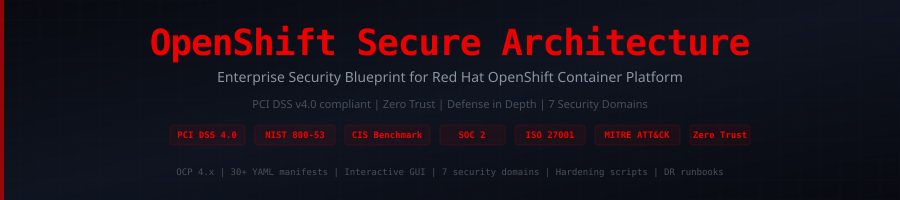

<div align="center">



</div>

# OpenShift Enterprise Secure Architecture Blueprint

<p align="center">
  
  
  
  
  
  
</p>

<p align="center">
  <strong>A production-grade, PCI DSS v4.0 compliant security architecture blueprint for Red Hat OpenShift Container Platform in enterprise environments.</strong>
</p>

---

## Table of Contents

- [Overview](#overview)
- [Architecture Diagram](#architecture-diagram)
- [Repository Structure](#repository-structure)
- [Quick Start](#quick-start)
- [Security Domains](#security-domains)
- [PCI DSS v4.0 Mapping](#pci-dss-v40-mapping)
- [Interactive GUI](#interactive-gui)
- [Contributing](#contributing)
- [Author](#author)

---

## Overview

This blueprint provides a **complete, enterprise-grade security architecture** for deploying and operating Red Hat OpenShift Container Platform (OCP 4.x) with full compliance to:

| Standard | Version | Coverage |
|----------|---------|----------|
| **PCI DSS** | v4.0 | All 12 Requirements |
| **NIST SP 800-53** | Rev 5 | High Baseline |
| **CIS Benchmarks** | OCP 4.x | Level 1 & 2 |
| **SOC 2 Type II** | 2024 | All Trust Principles |
| **ISO 27001** | 2022 | Annex A Controls |
| **MITRE ATT&CK** | v14 | Container Matrix |

### Key Features

- **Zero Trust Architecture** — Network microsegmentation, mTLS everywhere, identity-aware proxy
- **Defense in Depth** — 7-layer security model from infrastructure to application
- **Compliance Dashboard** — Interactive GUI for architecture visualization and compliance tracking
- **GitOps Security** — ArgoCD-driven policy enforcement with OPA/Gatekeeper
- 🕵️ **Runtime Security** — StackRox/ACS, Falco, and custom admission controllers
- 📦 **Supply Chain Security** — Sigstore, Cosign, SBOM generation, and image provenance
- 🌐 **Network Hardening** — Calico/OVN-Kubernetes policies, egress firewalling, service mesh
- 💾 **Data Protection** — Encryption at rest (LUKS2), in transit (TLS 1.3), and in use (SGX)

---

## Architecture Diagram

```
┌─────────────────────────────────────────────────────────────────────┐
│                        EXTERNAL BOUNDARY                            │
│  ┌──────────┐  ┌──────────┐  ┌──────────┐  ┌──────────────────┐   │
│  │ WAF/DDoS │  │ External │  │   CDN    │  │  DNS Security    │   │
│  │ (F5/CF)  │  │ LB (HA)  │  │          │  │  (DNSSEC)        │   │
│  └────┬─────┘  └────┬─────┘  └────┬─────┘  └────────┬─────────┘   │
│       └──────────────┼──────────────┘                │             │
│                      ▼                               ▼             │
│  ┌─────────────────────────────────────────────────────────────┐   │
│  │                    DMZ / INGRESS ZONE                        │   │
│  │  ┌──────────────┐  ┌──────────────┐  ┌──────────────────┐  │   │
│  │  │ HAProxy      │  │ OpenShift    │  │ Cert Manager     │  │   │
│  │  │ Ingress Ctrl │  │ Router       │  │ (Let's Encrypt)  │  │   │
│  │  └──────┬───────┘  └──────┬───────┘  └──────────────────┘  │   │
│  └─────────┼─────────────────┼─────────────────────────────────┘   │
│            ▼                 ▼                                      │
│  ┌─────────────────────────────────────────────────────────────┐   │
│  │              OPENSHIFT CONTROL PLANE (HA x3)                │   │
│  │  ┌────────────┐ ┌────────────┐ ┌────────────┐              │   │
│  │  │ API Server │ │ etcd       │ │ Controller │              │   │
│  │  │ (RBAC+OPA) │ │ (Encrypted)│ │ Manager    │              │   │
│  │  └────────────┘ └────────────┘ └────────────┘              │   │
│  │  ┌────────────┐ ┌────────────┐ ┌────────────┐              │   │
│  │  │ Scheduler  │ │ OAuth/OIDC │ │ Admission  │              │   │
│  │  │            │ │ (LDAP/AD)  │ │ Webhooks   │              │   │
│  │  └────────────┘ └────────────┘ └────────────┘              │   │
│  └─────────────────────────────────────────────────────────────┘   │
│                              │                                      │
│  ┌───────────────────────────┼─────────────────────────────────┐   │
│  │         WORKER NODE POOL (Auto-scaled, Multi-AZ)            │   │
│  │                           │                                  │   │
│  │  ┌───────────┐ ┌─────────┴──────┐ ┌───────────────────┐    │   │
│  │  │ App Tier  │ │ Service Mesh   │ │ PCI CDE Namespace │    │   │
│  │  │ Namespace │ │ (Istio/mTLS)   │ │ (Isolated)        │    │   │
│  │  │           │ │                │ │ ┌───────────────┐  │    │   │
│  │  │ ┌───────┐ │ │ ┌────────────┐ │ │ │ Payment Pods  │  │    │   │
│  │  │ │Pod+SC │ │ │ │ Envoy Proxy│ │ │ │ (Hardened)    │  │    │   │
│  │  │ └───────┘ │ │ └────────────┘ │ │ └───────────────┘  │    │   │
│  │  └───────────┘ └────────────────┘ └───────────────────────┘  │   │
│  │                                                              │   │
│  │  ┌──────────────────────────────────────────────────────┐    │   │
│  │  │              SECURITY & OBSERVABILITY                 │    │   │
│  │  │  StackRox/ACS │ Falco │ OPA │ Vault │ Prometheus     │    │   │
│  │  │  Grafana │ EFK Stack │ Jaeger │ Kyverno │ Trivy       │    │   │
│  │  └──────────────────────────────────────────────────────┘    │   │
│  └──────────────────────────────────────────────────────────────┘   │
│                              │                                      │
│  ┌───────────────────────────┼─────────────────────────────────┐   │
│  │              STORAGE & DATA LAYER                            │   │
│  │  ┌────────────┐ ┌────────┴───┐ ┌────────────────────────┐  │   │
│  │  │ ODF/Ceph   │ │ etcd       │ │ External DB (Encrypted)│  │   │
│  │  │ (LUKS2)    │ │ Backup     │ │ PostgreSQL/MySQL       │  │   │
│  │  └────────────┘ └────────────┘ └────────────────────────┘  │   │
│  └─────────────────────────────────────────────────────────────┘   │
│                                                                     │
│  ┌─────────────────────────────────────────────────────────────┐   │
│  │              CI/CD & SUPPLY CHAIN SECURITY                   │   │
│  │  Tekton │ ArgoCD │ Cosign │ Syft/SBOM │ Grype │ Quay       │   │
│  └─────────────────────────────────────────────────────────────┘   │
└─────────────────────────────────────────────────────────────────────┘
```

---

## Repository Structure

```
openshift/
├── README.md                          # This file
├── docs/
│   ├── architecture-overview.md       # Detailed architecture documentation
│   ├── deployment-guide.md            # Step-by-step deployment guide
│   ├── threat-model.md                # STRIDE threat modeling
│   └── compliance-matrix.md           # Full compliance mapping
├── policies/
│   ├── network-policies.yaml          # Kubernetes NetworkPolicy manifests
│   ├── opa-constraints.yaml           # OPA/Gatekeeper constraint templates
│   ├── kyverno-policies.yaml          # Kyverno cluster policies
│   └── pod-security.yaml              # Pod Security Standards (Restricted)
├── hardening/
│   ├── cluster-hardening.yaml         # CIS Benchmark hardening manifests
│   ├── node-hardening.sh              # RHCOS node hardening script
│   ├── etcd-encryption.yaml           # etcd encryption configuration
│   └── scc-profiles.yaml              # Security Context Constraints
├── network/
│   ├── ingress-config.yaml            # Ingress controller hardening
│   ├── egress-firewall.yaml           # Egress traffic restrictions
│   ├── service-mesh.yaml              # Istio/OSSM configuration
│   └── calico-policies.yaml           # Calico network policies
├── rbac/
│   ├── cluster-roles.yaml             # Cluster-wide RBAC definitions
│   ├── namespace-roles.yaml           # Namespace-scoped roles
│   ├── service-accounts.yaml          # Service account configurations
│   └── oauth-config.yaml              # OAuth/OIDC integration
├── monitoring/
│   ├── prometheus-rules.yaml          # Security alerting rules
│   ├── grafana-dashboards.json        # Security monitoring dashboards
│   ├── falco-rules.yaml               # Runtime threat detection
│   └── audit-policy.yaml              # API server audit configuration
├── pci-dss/
│   ├── requirement-mapping.md         # PCI DSS v4.0 control mapping
│   ├── cde-namespace.yaml             # Cardholder Data Environment setup
│   ├── encryption-config.yaml         # Data encryption standards
│   └── access-controls.yaml           # PCI access control policies
├── ci-cd/
│   ├── tekton-pipeline.yaml           # Secure CI/CD pipeline
│   ├── argocd-config.yaml             # GitOps deployment config
│   ├── image-signing.yaml             # Cosign image signing
│   └── sbom-generation.yaml           # SBOM with Syft
├── disaster-recovery/
│   ├── backup-strategy.md             # Backup and recovery plan
│   ├── velero-config.yaml             # Velero backup configuration
│   └── dr-runbook.md                  # DR procedures and runbook
├── scripts/
│   ├── compliance-check.sh            # Automated compliance scanner
│   ├── security-audit.sh              # Security posture audit
│   └── cluster-bootstrap.sh           # Initial cluster security bootstrap
├── gui/
│   └── index.html                     # Interactive Architecture Dashboard
└── .github/
    └── workflows/
        └── security-scan.yml          # CI security scanning workflow
```

---

## Quick Start

### Prerequisites

- Red Hat OpenShift 4.12+ cluster
- `oc` CLI tool authenticated with cluster-admin
- HashiCorp Vault instance (for secrets management)
- Container registry (Quay.io recommended)

### 1. Bootstrap Cluster Security

```bash
# Clone the repository
git clone https://github.com/SiteQ8/openshift.git
cd openshift

# Run the security bootstrap
chmod +x scripts/cluster-bootstrap.sh
./scripts/cluster-bootstrap.sh

# Verify compliance
./scripts/compliance-check.sh
```

### 2. Apply Hardening

```bash
# Apply CIS Benchmark hardening
oc apply -f hardening/cluster-hardening.yaml

# Configure etcd encryption
oc apply -f hardening/etcd-encryption.yaml

# Apply Security Context Constraints
oc apply -f hardening/scc-profiles.yaml
```

### 3. Configure Network Security

```bash
# Apply network policies
oc apply -f policies/network-policies.yaml

# Configure egress firewall
oc apply -f network/egress-firewall.yaml

# Deploy service mesh
oc apply -f network/service-mesh.yaml
```

### 4. Enable Monitoring

```bash
# Deploy Prometheus rules
oc apply -f monitoring/prometheus-rules.yaml

# Deploy Falco runtime security
oc apply -f monitoring/falco-rules.yaml
```

### 5. Launch Interactive Dashboard

Open `gui/index.html` in your browser or visit the [GitHub Pages site](https://siteq8.github.io/openshift/).

---

## Security Domains

### 1. Infrastructure Security
- RHCOS immutable operating system with SELinux enforcing
- FIPS 140-2/3 cryptographic modules enabled
- Secure boot with TPM 2.0 attestation
- Node auto-patching with Machine Config Operator

### 2. Cluster Hardening
- CIS Benchmark Level 2 compliance
- etcd encryption with AES-256-GCM
- API server audit logging (full request/response)
- Admission controllers (OPA Gatekeeper + Kyverno)

### 3. Identity & Access Management
- OIDC/LDAP/Active Directory integration
- Multi-factor authentication (MFA) enforcement
- Just-In-Time (JIT) privileged access
- Service account token auto-rotation

### 4. Network Security
- Zero Trust network model with microsegmentation
- Mutual TLS (mTLS) via service mesh for all east-west traffic
- Egress traffic whitelisting and inspection
- Network Policy enforcement at namespace boundaries

### 5. Supply Chain Security
- Image signing with Cosign/Sigstore
- SBOM generation with Syft for every build
- Vulnerability scanning with Trivy + Grype
- Trusted registry enforcement (Quay.io)

### 6. Runtime Security
- Red Hat ACS (StackRox) for runtime detection
- Falco for syscall-level monitoring
- Read-only root filesystem enforcement
- Seccomp and AppArmor profiles

### 7. Data Protection
- Encryption at rest (LUKS2 for ODF, etcd encryption)
- Encryption in transit (TLS 1.3 minimum)
- HashiCorp Vault for secrets management
- Automated key rotation policies

---

## PCI DSS v4.0 Mapping

| PCI DSS Requirement | OpenShift Implementation | Status |
|---------------------|-------------------------|--------|
| **Req 1**: Network Security Controls | NetworkPolicy, Calico, Egress Firewall | ✅ |
| **Req 2**: Secure Configurations | CIS Benchmarks, SCC, Machine Config | ✅ |
| **Req 3**: Protect Stored Data | LUKS2, etcd Encryption, Vault | ✅ |
| **Req 4**: Encrypt Transmissions | TLS 1.3, mTLS via Service Mesh | ✅ |
| **Req 5**: Malware Protection | ACS Runtime, Falco, Image Scanning | ✅ |
| **Req 6**: Secure Development | Tekton SAST/DAST, Signed Images | ✅ |
| **Req 7**: Restrict Access | RBAC, Namespace Isolation, JIT | ✅ |
| **Req 8**: Identify Users | OIDC/LDAP, MFA, Token Rotation | ✅ |
| **Req 9**: Physical Access | Cloud Provider Controls + Audit | ✅ |
| **Req 10**: Log & Monitor | EFK Stack, Prometheus, Audit Logs | ✅ |
| **Req 11**: Test Security | Compliance Operator, CIS Scans | ✅ |
| **Req 12**: Security Policies | Policy-as-Code, GitOps Enforcement | ✅ |

---

## Interactive GUI

The dashboard includes a login screen for access control:

| Credential | Value |
|------------|-------|
| **Username** | `admin` |
| **Password** | `OCP@Secure2025` |

Features include compliance radar chart, risk distribution doughnut, control coverage by domain, and full architecture visualization.

### Launch

The blueprint includes an interactive web dashboard for visualizing the architecture and tracking compliance:

**🌐 Live Demo**: [https://siteq8.github.io/openshift/gui/](https://siteq8.github.io/openshift/gui/)

Features:
- Interactive architecture topology viewer
- PCI DSS compliance tracker with progress indicators
- Security control inventory with status monitoring
- CIS Benchmark scoring dashboard
- MITRE ATT&CK coverage heatmap
- Network policy visualization
- Real-time risk assessment matrix

---

## Author

**Ali AlEnezi** ([@SiteQ8](https://github.com/SiteQ8))

Cybersecurity Architect | Kuwait 🇰🇼

- GitHub: [github.com/SiteQ8](https://github.com/SiteQ8)
- Email: Site@hotmail.com

---

## License

This project is licensed under the MIT License - see the [LICENSE](LICENSE) file for details.

---

<p align="center">
  <strong>Built with ❤️ for the cybersecurity community</strong><br>
  <em>Securing containers, one policy at a time.</em>
</p>
